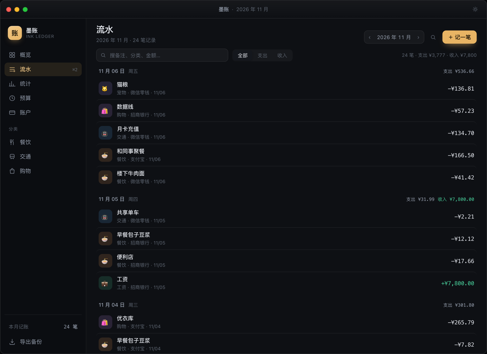
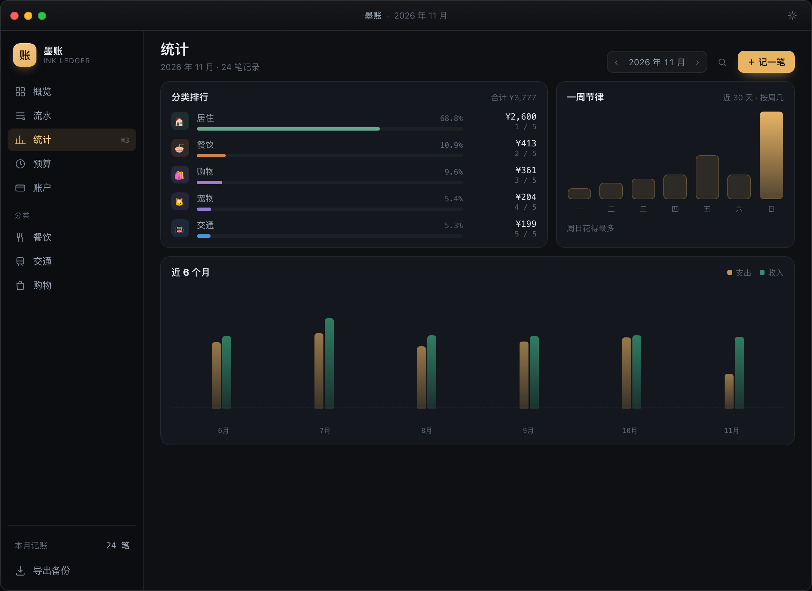
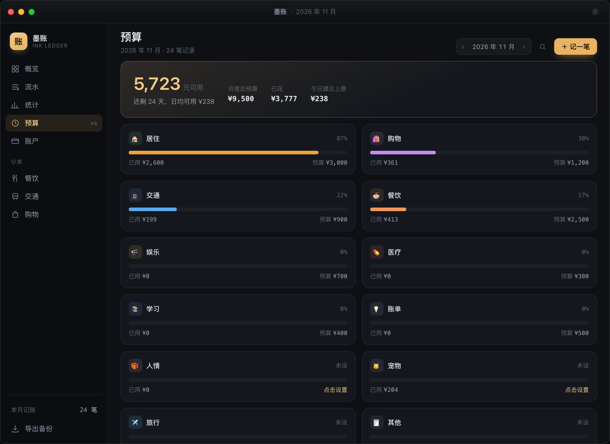
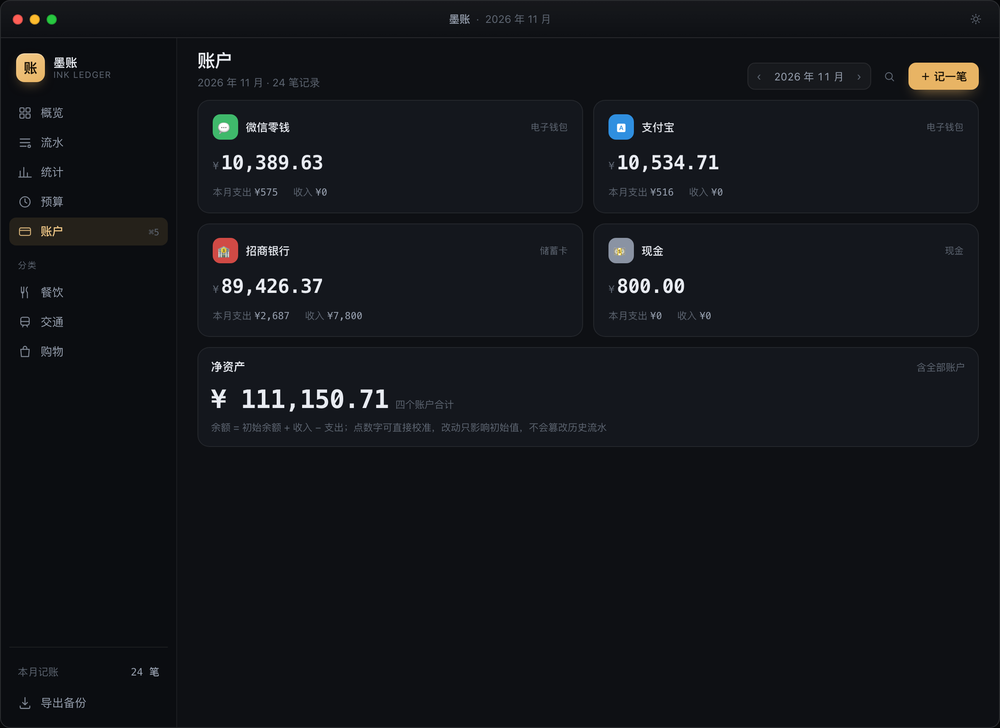
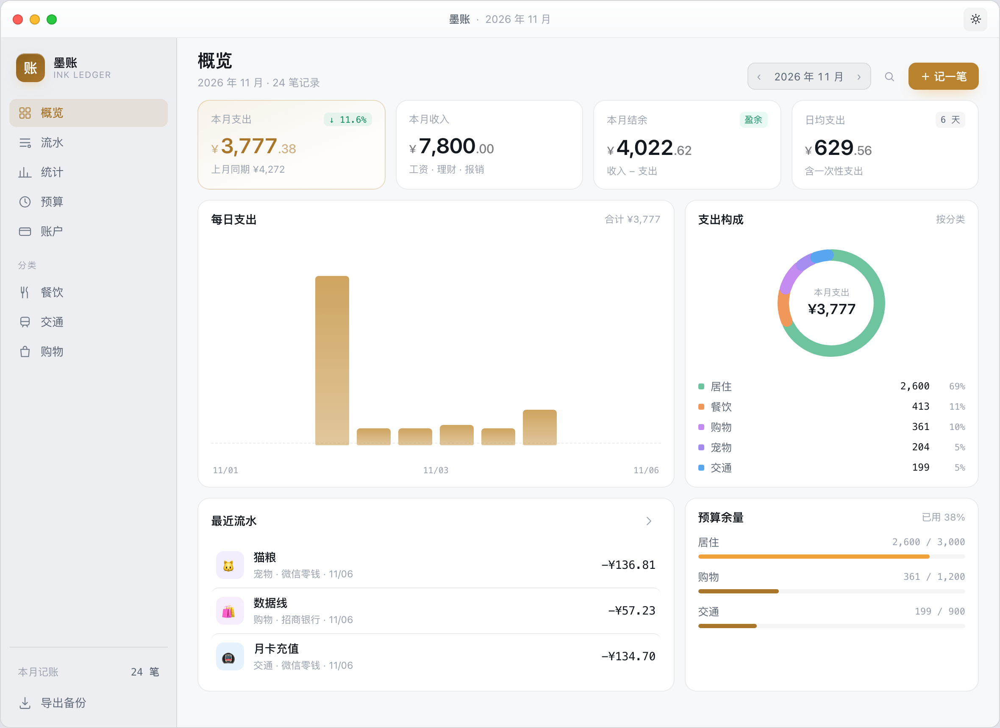

# 墨账 · Ink Ledger

[](https://github.com/wuteng606/ink-ledger/actions/workflows/release.yml)
[](https://github.com/wuteng606/ink-ledger/actions/workflows/ci.yml)
[](./LICENSE)

一个 Mac / Windows 桌面端的记账小工具。打开就能记，关掉就安静待着——没有账号、没有同步、没有广告。


## 它是什么

一笔一笔记得清楚，也看得明白钱去哪了。金额用整数「分」存储，账户余额由流水算出来，账永远对得上。

安装包 6.6 MB，冷启动约 1 秒，数据全在本机。

## 功能

### 概览：一眼知道这个月花成什么样

四张指标卡（本月支出 / 收入 / 结余 / 日均）+ 每日柱状图 + 分类环形图 + 最近流水 + 预算余量。
柱状图上悬停看当天金额；支出跟**上月同期**对比——不会因为月没过完就显示"大幅下降"。

### 记一笔：三步，不打断手头的事

`⌘N` 打开弹窗，金额、分类、账户、日期、备注。12 个支出分类 + 6 个收入分类，六列排开一眼能找到。
双击流水里任意一条可以改，悬停出现删除按钮。


### 快速记账：全局 `⌥⌘N` 唤起浮窗

浮窗贴在菜单栏图标下方，浮在全屏应用之上，不切走你的当前窗口。
金额 → 选分类 → 回车，记完自动收起。适合"刚付完钱顺手记一下"。


### 流水：按月、按日、可搜可筛

按日分组，每组小计当天收支；顶部搜备注 / 分类 / 金额，按支出、收入筛选。
点侧边栏的「餐饮 / 交通 / 购物」直接跳到对应分类。



### 统计：钱到底花在哪儿

分类排行带百分比条、近 30 天的「一周节律」（周几最容易超支）、近 6 个月收支对比。



### 预算：超支之前先提醒

按月给分类设预算，点预算数字直接改。用到 80% 变黄，100% 变红。
顶部实时算出「还剩多少天、日均可用多少」。



### 账户：余额是算出来的，不是手填的

余额 = 初始余额 + Σ收入 − Σ支出。点余额可以直接校准，改动只落在初始余额上，不会篡改任何一条历史流水。



### 深浅两套外观

右上角太阳图标切换，偏好记在本机。主窗口和快速记账浮窗会同步。



## 下载

到 [Releases](https://github.com/wuteng606/ink-ledger/releases) 下载：

- **macOS（Universal，Apple Silicon + Intel）**：`*_universal.dmg`，打开后把「墨账」拖进「应用程序」
- **Windows**：`*_x64-setup.exe`，双击安装

> 安装包未做代码签名 / 公证：
> - macOS 首次打开若被系统拦下，右键 App →「打开」，或到「系统设置 › 隐私与安全性」里放行。
> - Windows SmartScreen 提示"未知发布者"时，点「更多信息 → 仍要运行」。

## 快捷键

macOS 用 `⌘`，Windows 用 `Ctrl`，下表以 macOS 写法为例。

| 操作 | 快捷键 |
| --- | --- |
| 快速记账（全局，浮窗） | `⌥ ⌘ N` |
| 记一笔（主窗口） | `⌘ N` |
| 切到概览 / 流水 / 统计 / 预算 / 账户 | `⌘ 1` – `⌘ 5` |
| 弹窗内保存 | `⌘ ↵` |
| 关闭弹窗 / 收起浮窗 | `Esc` |

## 数据在哪

```
macOS    ~/Library/Application Support/com.inkledger.desktop/
Windows  %APPDATA%\com.inkledger.desktop\
├── ledger.db          主库（SQLite，WAL）
└── backups/           每日快照，保留最近 14 份
```

侧边栏底部「导出备份」导出 CSV（UTF-8 BOM，Excel 直接打开不乱码）。

**金额一律用整数「分」存储**，前端只在渲染时除以 100。浮点求和在记账工具里迟早会漂，这个坑不能踩。

## 自己构建

需要 [Rust](https://rustup.rs)、Node 20+，以及 [Tauri 的平台依赖](https://tauri.app/start/prerequisites/)。

```bash
npm install
npm run app:dev      # 开发模式（自动起 vite）
npm run app:build    # 打包 .app / .dmg / .exe
```

只调界面的话可以不起 Tauri：

```bash
npm run dev          # 浏览器打开 http://localhost:1421，用内存假数据
```

`src/lib/mock.ts` 提供了一套接口形状与 Rust 完全一致的假后端，改 UI 不用等 Rust 编译。

Rust 侧数据库逻辑有 12 个单元测试：

```bash
cd src-tauri && cargo test
```

调试时可以用环境变量把数据目录挪到项目内：

```bash
INK_LEDGER_DATA_DIR="$PWD/.devdata" npm run app:dev
```

## 技术栈

| 层 | 选型 |
| --- | --- |
| 外壳 | Tauri 2（Rust，macOS WKWebView / Windows WebView2） |
| 前端 | React 19 + TypeScript + Vite 6 |
| 样式 | 原生 CSS 变量，深浅两套，无 UI 框架 |
| 图表 | 手写 SVG（柱状 / 环形），零图表库依赖 |
| 数据 | SQLite + rusqlite（bundled），WAL 模式 |

## 目录

```
mini-ledger/
├── design/                    设计稿与截图
│   └── ui-preview.html        可交互的设计稿，浏览器直接打开
├── docs/tech-plan.md          技术方案
├── src/
│   ├── App.tsx                主窗口
│   ├── QuickApp.tsx           快速记账浮窗
│   ├── components/            StatCard、TrendBars、DonutChart、FlowRow、EntryModal…
│   ├── pages/                 Overview、Flow、Stats、Budget、Accounts
│   ├── lib/
│   │   ├── api.ts             IPC 封装（浏览器里自动切 mock）
│   │   ├── mock.ts            开发用假数据
│   │   ├── store.tsx          全局状态
│   │   └── money.ts           分 / 元换算
│   └── styles/
└── src-tauri/
    └── src/
        ├── main.rs            窗口装配、托盘、全局快捷键
        ├── db.rs              建表、迁移、聚合查询、导出备份
        └── commands.rs        IPC 命令
```

## 还没做的

- 分类目前是内置 18 个，暂不支持自定义增删
- 只支持手动记账，微信 / 支付宝账单导入排在下个版本
- 单账本，没有多账本 / 多人协作
- 没有云同步，也不打算加

## License

[MIT](./LICENSE)
